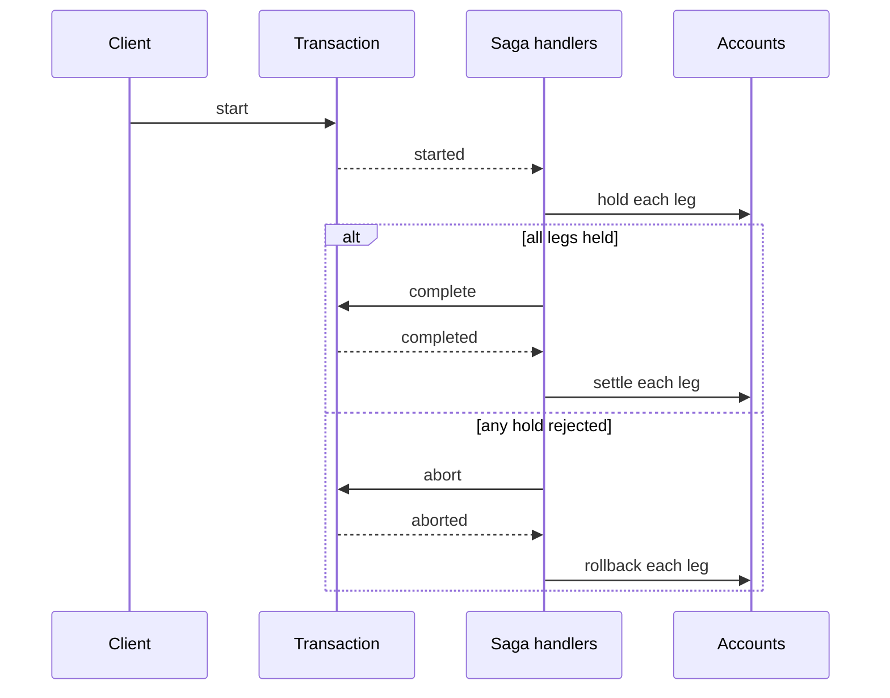

# caravan-ledger

[](https://github.com/SagynyshBaitursinov/caravan-ledger/actions/workflows/test.yml)
[](LICENSE)

**Demo:** Event-sourced double-entry ledger built on [events-caravan](https://github.com/SagynyshBaitursinov/events-caravan). 

The caravan-ledger architecture is designed to scale horizontally with the number of accounts and transactions between them.
Following the principles of the framework, design decisions are made to prioritize partition tolerance and high availability,
while acknowledging eventual consistency as a compromise. The business processes must be built with this fact in mind.

## Design

- `Transaction` and participating `Account`s state is eventually consistent. Between `started` and the last `settle`, funds are held, not spendable and not lost. No double spending is possible.
- Every write into DB touches one entity only at a time: one `Account` or one `Transaction`. No locks, no DB transaction spanning several entities.
- A `Transaction` is a choreography saga over `Account`s ([docs/transaction_saga.md](docs/transaction_saga.md)).
- Different `Account`s and `Transaction`s can be stored in different data stores. Throughput grows with number of nodes in the cluster.
- The demo leaves out General Ledger, Idempotence guarantees, "hot" Account handling and other features while focusing on Transaction saga and entities' design around events-caravan.

Solid arrows are writes, one entity at a time. Dashed arrows are events, delivered at least once.



## Modules

| Module                                  | Purpose                                                        |
|-----------------------------------------|----------------------------------------------------------------|
| caravan-ledger                          | Ledger domain (entities, events, handlers)                     |
| caravan-ledger-integration-tests        | End-to-end tests with the events-caravan starters on local AWS |

## Running locally

Prerequisites: **Java 25**, **Docker**, **AWS CLI**. AWS is emulated by [ministack](https://hub.docker.com/r/ministackorg/ministack)
on `localhost:4566` with dummy credentials, no AWS account is needed.

### 1. Run tests

```bash
./local/test            # starts local AWS, runs unit and integration tests, tears local AWS down
```

Or step by step: `./local/env-up`, then `./local/execute-tests` as many times as needed, then `./local/env-down`.

### 2. Run the application

```bash
./local/run             # starts local AWS and the application listening on localhost:8080, Ctrl+C stops both
```

Or, against an already running local AWS: `./local/env-up` once, then `./local/run-spring-boot`.

### 3. Try it manually

Open two accounts. Every argument is required:

```bash
curl -i -X POST localhost:8080/accounts \
  -H 'Content-Type: application/json' \
  -d '{"currency": "EUR", "overdraftAllowed": true}'
```
```
HTTP/1.1 201
Location: /accounts/5f0e8a21-...

{"accountId":"5f0e8a21-..."}
```

```bash
curl -i -X POST localhost:8080/accounts \
  -H 'Content-Type: application/json' \
  -d '{"currency": "EUR", "overdraftAllowed": false}'
```
```
HTTP/1.1 201
Location: /accounts/bc31eac7-...

{"accountId":"bc31eac7-..."}
```

Start a `Transaction`. Without overdraft, an account has to be credited before it can be debited:

```bash
curl -i -X POST localhost:8080/transactions \
  -H 'Content-Type: application/json' \
  -d '{
        "legs": [
          {"accountId": "5f0e8a21-...", "type": "DEBIT", "amount": {"amount": 250.00, "currency": "EUR"}},
          {"accountId": "bc31eac7-...", "type": "CREDIT", "amount": {"amount": 250.00, "currency": "EUR"}}
        ]
      }'
```
```
HTTP/1.1 201
Location: /transactions/cdb9d5e5-...

{"transactionId":"cdb9d5e5-..."}
```

The saga is asynchronous: `status` goes from `PENDING` to `COMPLETED` or `ABORTED` (with `abortionReason`), balances on accounts follow after a moment.

```bash
curl localhost:8080/transactions/cdb9d5e5-...
# {"transactionId":"cdb9d5e5-...","status":"COMPLETED","startTimestamp":"...","legs":[...]}

curl localhost:8080/accounts/bc31eac7-...
# {"accountId":"bc31eac7-...","balance":{"amount":250.00,"currency":"EUR"},"availableBalance":{"amount":250.00,"currency":"EUR"},"overdraftAllowed":false}

curl localhost:8080/accounts/5f0e8a21-...
# {"accountId":"5f0e8a21-...","balance":{"amount":-250.00,"currency":"EUR"},"availableBalance":{"amount":-250.00,"currency":"EUR"},"overdraftAllowed":true}
```

## License

[Apache License 2.0](LICENSE)
